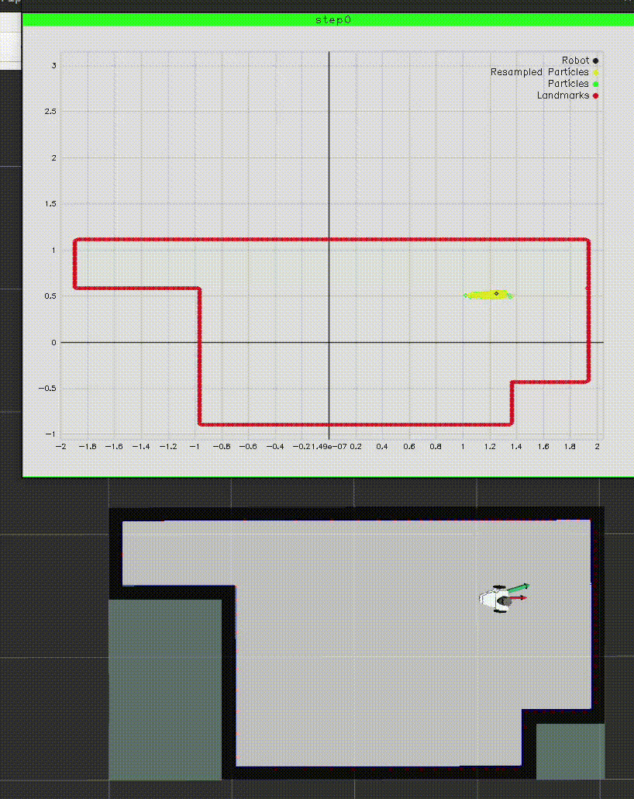
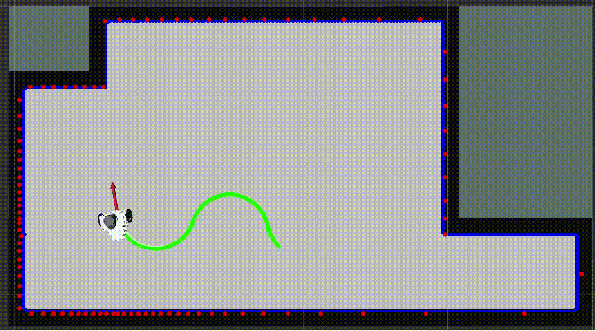
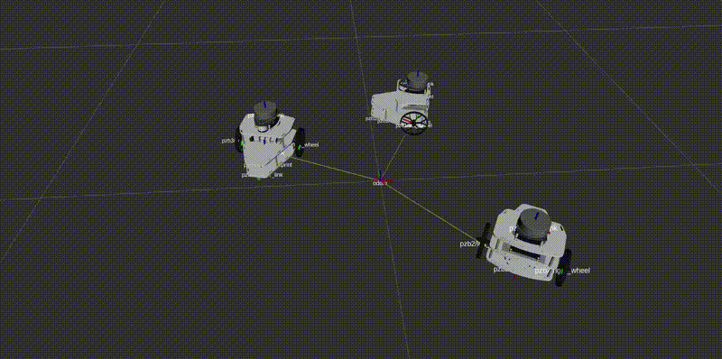

# Turbo++ IntegracionRobotica TE3003B.501

<!-- For when 2 images / gifs -->
<!-- <div align="center">
  
  
</div> -->

<div align="center">
  
</div>

<div align="center">
  
</div>


<div style="clear:both; margin-bottom:340px;"></div>

## Configuration Manual

### Prerequisites

To run the contents of this repository, make sure you have the following:

1. Ubuntu 22.04

If you do not have Ubuntu installed, you can look at this [Disk partition for Dual Booting with Windows and Ubuntu 22][dual-boot].

2. ROS 2 Humble

If you do not have this distribution installed, [read the following installation guide][ros2].

3. GZ SIM Harmonic

If you do not have this version of Gz sim installed, [read the following installation guide][gz].


Install the ros_gz package with:
```
sudo apt-get install ros-humble-ros-gz
```

4. CUDA 12.8 Toolkit

Download [here][cuda].


### Getting this repository
```Shell
# Clone the repository and initialize submodules
git clone https://github.com/MaxPacheco02/TurboPlusPlus_IntegracionRobotica.git
cd TurboPlusPlus_IntegracionRobotica

# Very important!
git submodule update --init --recursive
```

### Setting up Model Predictive Control libraries

For the repository libraries at `./src/TurboPlusPlus_ImplementacionRobotica/pzb_ws/pzb_control/libs/`, fatrop and rockit, do the following (from this directory):

```Shell
# Travel to the first lib
cd src/TurboPlusPlus_ImplementacionRobotica/pzb_ws/pzb_control/libs/fatrop

# Follow the repo's build instructions.
export CMAKE_ARGS="-DBLASFEO_TARGET=X64_AUTOMATIC -DENABLE_MULTITHREADING=OFF"
cd fatropy 
pip install .

# Also setup the second lib which is interfaced via fatrop (first lib)
cd ../..
cd rockit/rockit/external/fatrop
git clone https://gitlab.kuleuven.be/u0110259/rockit_fatrop_plugin.git
cd ../../..
pip install .
```

**_NOTE:_**  Because the libraries seem to currently be in beta phase, we'll use previous commits. That's why the submodules have a detached head to a version developed around September 2024.

## Enjoy the functionalities!

### Teleoperating the robot using the kinematic model
```Shell
# Terminal 1
ros2 launch pzb_control pzb_control_launch.py

# Terminal 2
rviz2 -d ~/TurboPlusPlus_IntegracionRobotica/src/pzb_description/rviz/rviz2.rviz

# Terminal 3
ros2 launch pzb_description rviz_launch.py

# Terminal 4
ros2 run pzb_control pzb_teleop_low_level_node.py
```

### Teleoperating the robot using GZ SIM
```Shell
# Terminal 1
ros2 launch pzb_description gz_launch.py

# Terminal 2
rviz2 -d ~/TurboPlusPlus_IntegracionRobotica/src/pzb_description/rviz/rviz2.rviz

# Terminal 3
ros2 launch pzb_description rviz_launch.py

# Terminal 4
ros2 run pzb_control pzb_teleop_low_level_node.py
```

### Controlling 3 robots at once
```Shell
# Terminal 1
rviz2 -d ~/TurboPlusPlus_IntegracionRobotica/src/pzb_description/rviz/multiple.rviz

# Terminal 2
ros2 launch pzb_swarm multi_robot_launch.py
```

### Run SLAM with CUDA
```Shell
# Terminals 1-4
# Run the GZ SIM Teleoperating Instructions

# Terminal 5 
ros2 run pzb_localization mcl_node
```

## Team members:
### *Andrés Carrizales - A00832679*
### *Daniel Castañon - A01284991*
### *Demian Marin - A01368643*
### *Max Pacheco - A01552369*
### *Neil Hernandez - A01284713*


[dual-boot]: https://www.youtube.com/watch?v=QKn5U2esuRk
[ros2]: https://docs.ros.org/en/humble/Installation/Ubuntu-Install-Debs.html
[gz]: https://gazebosim.org/docs/harmonic/install_ubuntu
[cuda]: https://developer.nvidia.com/cuda-12-8-0-download-archive