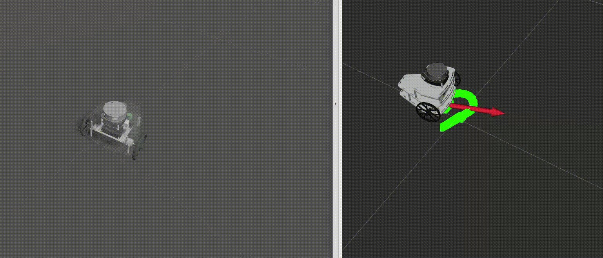

# Turbo++ IntegracionRobotica TE3003B.501

<p align="center">
  
</p>
<p align="center">
  
</p>

## Configuration Manual

### Prerequisites

To run the contents of this repository, make sure you have the following:

1. Ubuntu 22.04

If you do not have Ubuntu installed, you can look at this [Disk partition for Dual Booting with Windows and Ubuntu 22][dual-boot].

2. ROS 2 Humble

If you do not have this distribution installed, [read the following installation guide][ros2].

3. GZ SIM Garden

If you do not have this version of Gz sim installed, [read the following installation guide][gz].

Aftere installing Gazebo Sim Garden, add the following lines to your ~/.bashrc file.

```Shell
export GZ_SIM_RESOURCE_PATH=:<path-to-this-repo>/src/pzb_description/models:$GZ_SIM_RESOURCE_PATH
export GZ_VERSION=garden
```

After installation, clone in a separate general ros2 workspace the ros_gz package, for communication between ROS2 and Gazebo Sim.
```Shell
cd 
mkdir -p ros2_ws/src
cd ros2_ws/src
git clone https://github.com/gazebosim/ros_gz.git -b caguero/humble_garden
cd ..
colcon build

# Also, remember to always source the package before using it, or add the following line to your ~/.bashrc
source ros2_ws/install/setup.bash
```

Also install the following dependencies:

```Shell
sudo apt-get install libgflags-dev libignition-transport11-dev libignition-gazebo6 libignition-gazebo6-dev 
```

### Running this repository
```Shell
# Clone the repository and initialize submodules
git clone https://github.com/MaxPacheco02/TurboPlusPlus_IntegracionRobotica.git
cd TurboPlusPlus_IntegracionRobotica
git submodule update --init --recursive

# Build the ROS2 workspace
colcon build

# Start running the nodes!

```

### Teleoperating the robot using the kinematic model
```Shell
# Terminal 1
ros2 launch pzb_control pzb_control_launch.py

# Terminal 2
rviz2 -d ~/TurboPlusPlus_IntegracionRobotica/src/pzb_description/rviz/rviz2.rviz

# Terminal 3
ros2 launch pzb_description rviz_launch.py

# Terminal 4
ros2 run pzb_control pzb_teleop_low_level_node.py
```

### Teleoperating the robot using GZ SIM
```Shell
# Terminal 1
ros2 launch pzb_description gz_launch.py

# Terminal 2
rviz2 -d ~/TurboPlusPlus_IntegracionRobotica/src/pzb_description/rviz/rviz2.rviz

# Terminal 3
ros2 launch pzb_description rviz_launch.py

# Terminal 4
ros2 run pzb_control pzb_teleop_low_level_node.py
```

## Team members:
### *Andrés Carrizales - A00832679*
### *Daniel Castañon - A01284991*
### *Demian Marin - A01368643*
### *Max Pacheco - A01552369*
### *Neil Hernandez - A01284713*


[dual-boot]: https://www.youtube.com/watch?v=QKn5U2esuRk
[ros2]: https://docs.ros.org/en/humble/Installation/Ubuntu-Install-Debs.html
[gz]: https://gazebosim.org/docs/garden/install_ubuntu
